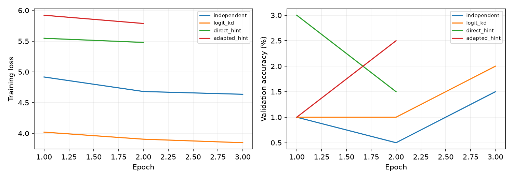
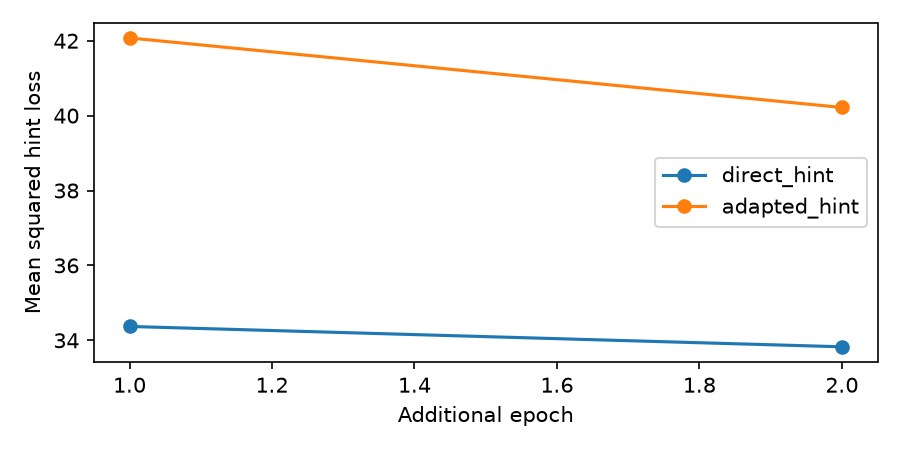
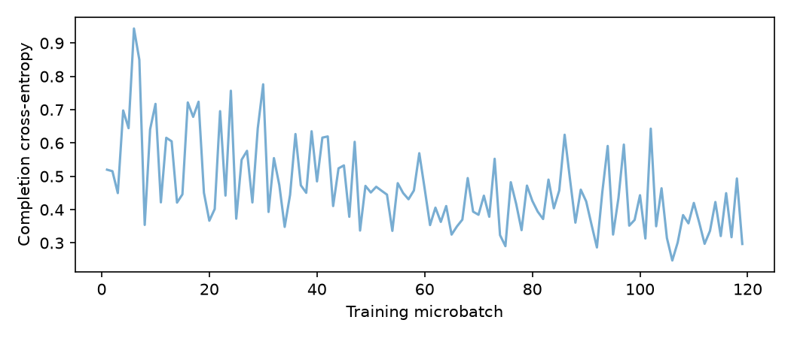
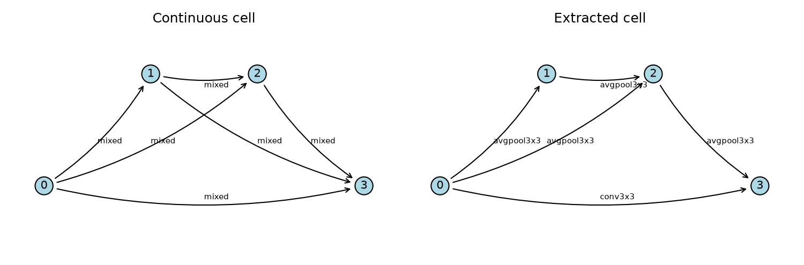
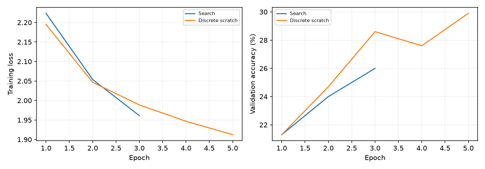
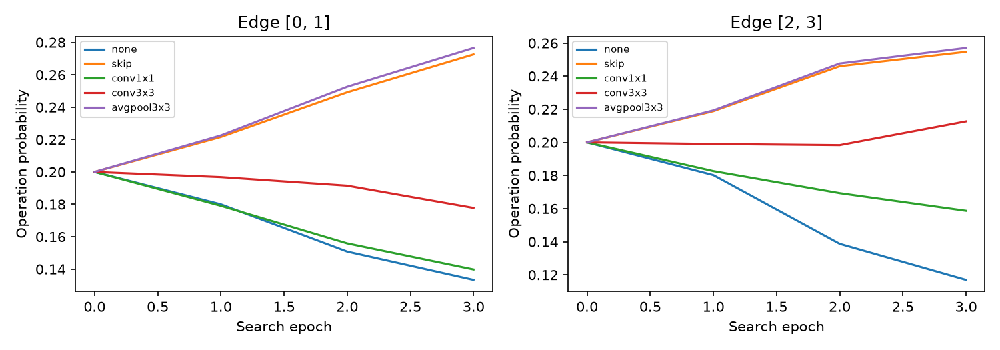
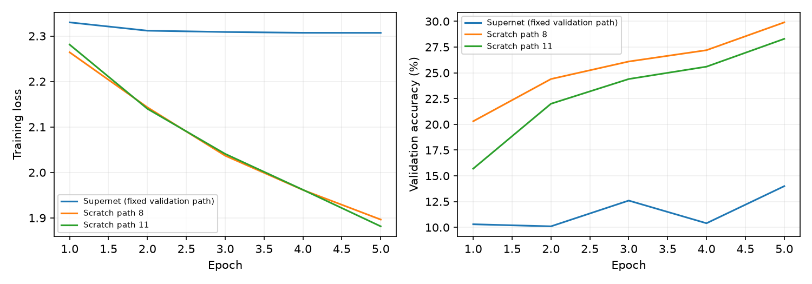
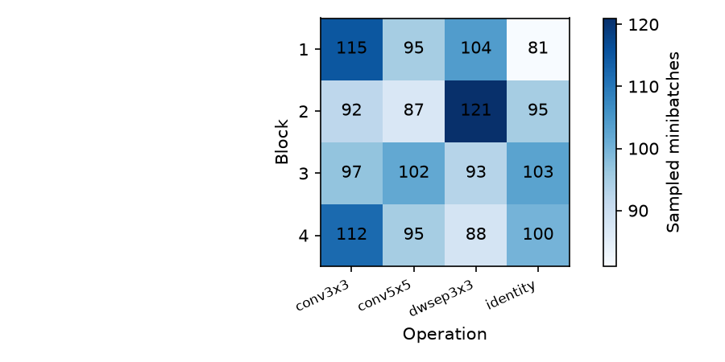
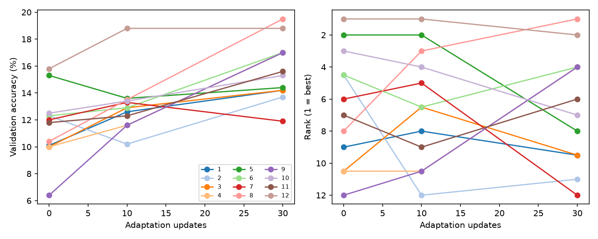
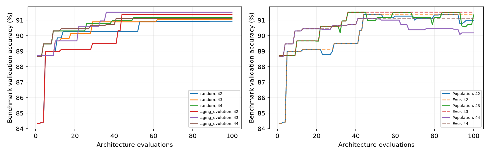

# AI624 Assignment 4: Results

**Name:** Muhammad Sami Ul Basit  
**Roll No:** 25280025

## Experimental setup

All training and model inference ran on Intel(R) Arc(TM) 140T GPU (23GB) using PyTorch 2.14.1+xpu. CNN experiments used FP32; the language models used BF16. The NPU was not needed. Python/package versions are recorded in `results/environment.json`; training budgets and seeds appear under each task. Timings are measured wall time, including validation within training loops but excluding downloads. Latency uses batch size 1, ten warm-ups and twenty synchronized timed forwards, reporting the median and excluding data loading. Initial per-training-run latency varied substantially on this integrated GPU; final report values come from a separate post-training, seeded shuffled round-robin comparison of the saved models in `notebooks/reprofile.ipynb`. All raw samples are retained. Results are single-run measurements except the three-seed T5 searches. There is no minimum target accuracy in the assignment, and short training budgets limit the conclusions.

## T1.1: Independent Training and Logit KD

**Q1.** Did KD improve accuracy or convergence? Compare the training curves and final results. Did KD change the student's inference cost?

**Answer:**

| Model | Top-1 (%) | Top-5 (%) | Parameters | Median latency (ms) |
| --- | --- | --- | --- | --- |
| EfficientNet-B7 teacher | 85.00 | 96.50 | 66347960 | 61.11 |
| Independent | 1.50 | 7.50 | 4135648 | 9.87 |
| Logit KD | 2.00 | 7.50 | 4135648 | 9.95 |

Both B0 models began with identical weights and used seed 42, Adam (learning rate 0.001), batch size 16, three epochs and 96 updates each. The fixed subset contains 500 training and 200 validation images, covering 100 and 100 classes respectively; no test set was used for model selection. Systematic blocks span the class-ordered source, with the two short-class gaps filled from their midpoint rows to give exactly five training images per class. Image indices are stored with the subset tensors; the 100-label mapping is in `results/imagenet_class_mapping.json`. The source is `clane9/imagenet-100`, whose images are already reduced to a 160-pixel short side; we resize to 224 x 224 and apply ImageNet normalization. No random augmentation is used. Teacher logits are cached in FP32; hint maps use FP16 storage and are converted to FP32 for MSE, introducing small storage quantization error.

$$L_{KD}=(1-\lambda)L_{CE}+\lambda T^2\,D_{KL}(p_T(T)\Vert p_S(T)),\quad T=3,\quad\lambda=0.5.$$

KD changed final Top-1 accuracy by +0.50 percentage points and Top-5 by +0.00 points. Independent training CE fell from 4.917 to 4.636; KD training CE fell from 4.821 to 4.590. However, final validation CE was 12.606 and 10.069, respectively, and both Top-1 scores remained near the 1% chance level. Thus the students are substantially undertrained and the curves do not demonstrate stable validation convergence. The plotted objectives also differ: KD includes KL while the independent objective is CE; the JSON histories separately record CE. Both deployed students have exactly the same architecture and parameter count. Measured latency differences reflect runtime variability, not an extra KD operation at inference.



T1 training objectives and validation Top-1 accuracy. Hint epochs are additional epochs after the common KD checkpoint.

## T1.2: Feature Matching Without an Adapter

**Q1.** Report the teacher and student feature dimensions, hint-loss curve, and validation accuracy. Why can these features be compared directly? Does having the same shape mean they contain the same information?

**Answer:**

Teacher `features[1]` and student `features[0]` both produced [16, 32, 112, 112] on the first batch. No adapter was used. Two additional epochs (64 updates) from the logit-KD checkpoint gave Top-1 1.50% and Top-5 7.00%. Mean hint losses by epoch were 34.369860, 33.826464.

$$L=L_{KD}+0.05L_{hint},\qquad L_{hint}=\mathrm{MSE}(h_S,h_T).$$

Matching batch, channel and spatial dimensions permits elementwise MSE. Equal shapes do not imply equal information: independently learned channels need not represent the same patterns, scales or semantics. The teacher layer also includes an MBConv stage while the student layer is the stem.



Direct and adapted feature MSE during the two additional epochs.

## T1.3: Feature Matching With an Adapter

**Q1.** Show the feature shapes before and after the adapter, its parameter count, hint loss, and validation accuracy. Why is the adapter needed in this case?

**Answer:**

The student feature shape was [16, 80, 14, 14]; the teacher shape was [16, 224, 14, 14]. A trainable 1 x 1 convolution changed the student shape to [16, 224, 14, 14]. Its parameter count is 80 x 224 + 224 = 18,144, including bias. Checks confirmed nonzero gradients in both the student and adapter, with detached targets from a frozen teacher.

$$L_{hint}=\mathrm{MSE}(r_\theta(h_S),h_T).$$

The adapter is required because 80 student channels cannot be compared elementwise with 224 teacher channels. It learns a channel projection at each spatial location; both maps already have 14 x 14 spatial resolution. This run started from a separate copy of the same KD checkpoint. After 64 updates, Top-1 was 2.50% and Top-5 8.00%. Hint losses were 42.074500, 40.217751. The adapter is removed for deployment.

## T1.4: Final Comparison

**Q1.** Compare independent training, logit KD, direct feature matching, and adapted feature matching. Which configuration performed best? What additional training cost did feature matching introduce?

**Answer:**

| Configuration | Top-1 (%) | Top-5 (%) | Cumulative training loop (s) | Deployed parameters | Latency (ms) |
| --- | --- | --- | --- | --- | --- |
| Independent | 1.50 | 7.50 | 118.92 | 4135648 | 9.87 |
| Logit KD | 2.00 | 7.50 | 70.30 | 4135648 | 9.95 |
| Direct hint | 1.50 | 7.00 | 114.48 | 4135648 | 9.52 |
| Adapted hint | 2.50 | 8.00 | 114.21 | 4135648 | 10.36 |
The highest final Top-1 result was Adapted hint (2.50%). Direct and adapted hints added 44.18 s and 43.92 s, respectively, beyond KD training. Hint variants have two more epochs, so this is not an equal-total-budget comparison. Teacher target generation took 60.25 s (shared preprocessing cost, excluded from the table). Caching is possible because inputs and teacher weights are fixed. Feature training adds feature storage, transfer and MSE computation; the adapted case also adds projection parameters and gradients. None of these additions changes the deployed B0 inference graph.

## T2.1: Generate Held-Out Questions

**Q1.** Provide the generated dataset and teacher prompt. Describe how you checked the answers. Include examples of any errors encountered. How do your generated problems compare with GSM8K?

**Answer:**

The complete held-out set is `data/synthetic_questions.json`; the generation prompt is `results/synthetic_prompt.txt`. The set uses 20 multi-step arithmetic problem families, each instantiated with five deterministic parameter settings (100 unique questions). Generation uses programmatic parameter variants rather than 100 independent API completions. The explicit teacher prompt was:

> Generate 100 original GSM8K-style word problems with concise worked solutions ending in #### <value>. Use diverse multi-step arithmetic situations, unambiguous quantities, and exactly checkable integer answers. Keep these questions separate from GSM8K training. Include a programmatic arithmetic check for every answer.

All answers were recomputed with exact integer arithmetic from the stated quantities, and the final marker, uniqueness and count were checked. The chosen quantities make divisions exact; no synthetic arithmetic error was found. For example, the first problem makes 20 x 12 = 240 rolls, sells 2, and divides the remaining 238 between two shops: 119 rolls per shop. The full checking record is in `results/synthetic_checks.json`.

The set resembles GSM8K in short everyday stories and multi-step arithmetic, but has only 20 underlying structures, cleaner wording, exclusively integer final values and less linguistic diversity. Repeated structures make its accuracy a limited measure of general reasoning. No synthetic question or solution enters LoRA training.

## T2.2: Fine-Tune on Teacher Rationales

**Q1.** Report the number of training examples, trainable parameter count and percentage, training loss curve, and total training time. Briefly explain how the student learns from teacher-generated reasoning traces.

**Answer:**

| Training examples | Trainable parameters | Trainable (%) | Training loop (s) |
| --- | --- | --- | --- |
| 475 | 540672 | 0.11 | 103.19 |
A fixed seed-42 sample of 1,000 GSM8K training questions was answered by `Qwen/Qwen2.5-1.5B-Instruct`. 475 outputs matched the reference final number; 525 wrong or missing-answer outputs were excluded. An additional 0 accepted examples exceeded the 512-token budget and were excluded rather than truncating the rationale. The raw completions and accept/reject flags are in `data/teacher_rationales.json`. Matching the final answer does not establish that every intermediate reasoning step is correct.

For 430 accepted examples, a missing final-answer marker was corrected only because the last stated numerical value matched the GSM8K reference. Raw text is retained. Incorrect final numbers were never changed to reference values. The student is `Qwen/Qwen2.5-0.5B-Instruct`. LoRA uses rank 8, alpha 16 (scale 2), dropout 0.05, and `q_proj`/`v_proj` targets. AdamW uses learning rate 0.0002; microbatch size 4 with accumulation over 4 microbatches gives effective batch size up to 16. One epoch used 119 microbatches and 30 optimizer updates. The BF16 backbone is frozen; only LoRA parameters are trained. Prompt and padding tokens have label -100 and do not contribute to the objective. Teacher generation used SDPA attention in batches of 64. An Intel GPU resource failure during the initial student evaluation was resolved by switching both student evaluations to eager attention and batch size 8; no failed-run predictions were reused.

$$\Delta W=\frac{\alpha}{r}BA,\qquad L_{SFT}=-\sum_t\log p_\theta(y_t\mid x,y_{<t}).$$

The student learns to predict the teacher's calculation tokens and final answer, conditioned on the question and preceding completion tokens. This transfers a reasoning-output pattern using next-token supervision, without requiring teacher logits. The concise teacher prompt and all settings are in the notebook. A pilot prompt generated long responses that exceeded the token cap and responses such as `#### The total ... is 8 pounds`, which fail strict numerical extraction; those pilot records are retained separately and were not used for training.



Completion-only training cross-entropy for each microbatch.

## T2.3: Evaluate Reasoning

**Q1.** Compare the accuracy of the original and fine-tuned students on the real and synthetic questions. Show examples of correct and incorrect solutions. Did the model ever reach the correct answer through incorrect reasoning? How well did distillation transfer to the synthetic set?

**Answer:**

| Model | GSM8K accuracy (%) | Synthetic accuracy (%) |
| --- | --- | --- |
| Original student | 0.00 | 0.00 |
| Fine-tuned student | 19.50 | 21.00 |
Both students used the same 200 GSM8K test questions and all 100 synthetic questions, greedy decoding and a 192-token generation cap. Test questions were never used for model selection or training. Exact match extracts the last `####` numerical value, removes commas and compares normalized decimal values; missing markers count as incorrect. The fine-tuned model changed real-question accuracy by +19.50 points and synthetic accuracy by +21.00 points. The synthetic result applies to the limited family-based set described above, not unrestricted unseen arithmetic.

The review covers the same 20 questions for each model (10 GSM8K and 10 synthetic), giving 40 inspected solutions. The complete questions, raw outputs, references and individual reasoning assessments are in `results/t2_manual_review.json`. This is a targeted qualitative sample, not an estimate of the error rate across the whole dataset.

Formatting is a major confound: the original student produced a parseable required marker on 0/200 real and 1/100 synthetic questions, versus 148/200 and 96/100 after fine-tuning. Thus the strict exact-match gain cannot be interpreted solely as improved arithmetic. Some answers without the marker were mathematically correct; no reference-based formatting repair was applied to student evaluation outputs.

Examples from the inspected outputs:

| Set / ID | Model | Observed solution | Assessment |
|---|---|---|---|
| GSM8K / 645 | Original | 8 kg/portion x 3 bags = 24 kg | Omits 2 kg per portion; wrong reasoning and no marker. |
| GSM8K / 645 | Fine-tuned | 8 x 2 = 16; 16 x 3 = 48; `#### 48` | Correct reasoning and final answer. |
| GSM8K / 113 | Both | 2 x 15 - 5 = 25 | Both get the arithmetic right; only the fine-tuned output has `#### 25`. |
| GSM8K / 757 | Fine-tuned | 11 + 22 + 18 + 9 + 15 = 75; `#### 75` | Correct count relationships and sum; original used wrong large/extra-large counts. |
| GSM8K / 582 | Fine-tuned | 76000 x 0.3 = 22800; 76000 + 22800 = 98800 | Adds the discount amount instead of the discounted house value; reference is 129200. |
| Synthetic / 7 | Original / fine-tuned | Original evaluates 12 x 20 + 2 x 12 - 20 as 240; fine-tuned computes 264 - 20 = 244 | A genuine arithmetic correction, with a valid `#### 244` after fine-tuning. |
| Synthetic / 0 | Fine-tuned | 240 - 2 = 238; 238 / 2 = 119 | Correct arithmetic, still rejected because it uses a boxed answer instead of the required marker. |
| Synthetic / 1 | Original / fine-tuned | Original correctly gets 111; fine-tuned gives `#### 220` | A regression in reasoning despite improved formatting. |

No correct numerical answer reached through demonstrably incorrect reasoning was found in these 40 inspected outputs. This does not rule out such cases elsewhere. The fine-tuned model also truncates a correctly started ratio solution (GSM8K 116) before reaching its final answer, showing that the 192-token cap can reduce measured accuracy. Transfer to synthetic questions is mixed: some multiplication/subtraction errors are corrected, but unit errors, omitted quantities and regressions remain. The lower-diversity synthetic set and answer-format sensitivity limit any claim of broad reasoning generalization.

## T3.1: Differentiable Cell

**Q1.** Show the cell graph, architecture parameter dimensions, and verification results. Explain why the architecture parameters can be optimized using gradients.

**Answer:**




Continuous four-node cell (six edges) and the extracted five-edge architecture; both networks contain two cells.
Each cell connects (0,1), (0,2), (1,2), (0,3), (1,3), (2,3). Candidates are none, skip, 1 x 1 convolution, 3 x 3 convolution, and 3 x 3 average pooling. Convolutional candidates use GroupNorm and ReLU. All operations preserve 16 channels and 32 x 32 resolution. The fixed 3 x 3 stem is followed by two searchable cells, global average pooling and a 10-class linear head.

$$p_{e,o}=\frac{e^{\alpha_{e,o}}}{\sum_{o'}e^{\alpha_{e,o'}}},\qquad x_j=\sum_{i<j}\sum_o p_{(i,j),o}\,o(x_i).$$

There is one shared architecture tensor of shape 6 x 5 (30 parameters). The cells own separate operation weights. Softmax and weighted sums are differentiable, so cross-entropy gradients reach the architecture parameters via the mixture coefficients. No discrete sampling occurs during continuous search.

| Verification | Observed value |
| --- | --- |
| output_shape | [64, 10] |
| alpha_shape | [6, 5] |
| probability_sums | [1.0, 1.0, 1.0, 1.0, 1.0, 1.0] |
| alpha_gradient_nonzero | True |
| separate_cell_weights | True |
| alpha_changes_output | True |

## T3.2: First-Order Search

**Q1.** Show parameter-update verification, training curves, and probability histories for at least two edges. Which operations became more likely during search?

**Answer:**

| Optimizer verification | Passed |
| --- | --- |
| weight_step_alpha_unchanged | True |
| weight_step_weights_changed | True |
| alpha_step_weights_unchanged | True |
| alpha_step_alpha_changed | True |
The seed-43 CIFAR-10 split contains exactly 500 training and 100 validation images per class, with no overlap. Inputs use fixed normalization and no random augmentation. Batch size is 64. Adam updates network weights at learning rate 0.001 using training batches; a separate Adam updates alpha at 0.003 using validation batches. Weight gradients are disabled for the architecture step and alpha gradients are disabled for the weight step. GroupNorm has no mutable running statistics. The validation iterator cycles as needed.

Three epochs performed 237 weight updates and 237 architecture updates, taking 58.98 s including epoch validation. This is first-order optimization; it does not differentiate through the weight update.



Training losses and validation accuracy for the search and fresh discrete network.



Probability histories for edges (0,1) and (2,3), including the uniform initialization.
Final highest-probability operations by edge: (0, 1): avgpool3x3 (0.277), (0, 2): avgpool3x3 (0.281), (1, 2): avgpool3x3 (0.248), (0, 3): conv3x3 (0.249), (1, 3): avgpool3x3 (0.227), (2, 3): avgpool3x3 (0.257).

## T3.3: Extract and Evaluate a Discrete Architecture

**Q1.** Compare the continuous supernet, inherited-weight model, and independently trained model. How much did performance change after discretization and independent training?

**Answer:**

| Model | Validation accuracy (%) | Parameters | Conv/linear MACs | Tensor size (MiB) | Median latency (ms) |
| --- | --- | --- | --- | --- | --- |
| Continuous supernet | 26.00 | 32136 | 31899808 | 0.12 | 5.35 |
| Discrete: inherited | 21.60 | 5290 | 5161120 | 0.02 | 0.71 |
| Discrete: scratch | 29.90 | 5290 | 5161120 | 0.02 | 0.66 |
Encoding: (0, 1) = avgpool3x3, (0, 2) = avgpool3x3, (1, 2) = avgpool3x3, (2, 3) = avgpool3x3, (0, 3) = conv3x3.

For each node we ranked incoming edges by their largest non-none probability, retained up to two, and selected the corresponding non-none operation. The five-edge architecture is shown above. The continuous and inherited models were evaluated from the same saved search checkpoint with no intervening fine-tuning. Discretization changed validation accuracy by -4.40 percentage points. Fresh initialization and five epochs (395 updates) changed it by +8.30 points relative to inherited weights. Scratch training took 12.61 s.

Parameters and MACs are analytical counts; latency is measured. MACs count convolution and linear multiply-accumulates only, excluding pooling, normalization, activations, softmax and mixture arithmetic. Tensor size counts serialized state tensors, excluding file-container overhead. Inherited and scratch models have the same computational graph; their latency difference is measurement/runtime variability, not an architectural change.

## T4.1: Supernet and Path Sampling

**Q1.** Show two example paths, their active operations, parameter mappings, and output shapes. How does weight sharing reduce the cost of searching a large number of architectures?

**Answer:**

| Path | Active operations | Output shape |
| --- | --- | --- |
| [0, 1, 2, 3] | ['conv3x3', 'conv5x5', 'dwsep3x3', 'identity'] | [64, 10] |
| [0, 2, 2, 1] | ['conv3x3', 'dwsep3x3', 'dwsep3x3', 'conv5x5'] | [64, 10] |

| Verification | Observed value |
| --- | --- |
| shared_blocks | [0, 2] |
| identity_parameters | 0 |
| extraction_matches | True |
| extraction_independent_storage | True |
| inactive_parameters_unchanged | True |
| active_parameters_changed | True |
| checked_path | [3, 0, 1, 3] |
| shared_operation_parameter_storage | {'0': True, '1': False, '2': True, '3': False} |

Mappings: blocks.0.0 -> subnet.blocks.0, blocks.1.1 -> subnet.blocks.1, blocks.2.2 -> subnet.blocks.2, blocks.3.3 -> subnet.blocks.3; blocks.0.0 -> subnet.blocks.0, blocks.1.2 -> subnet.blocks.1, blocks.2.2 -> subnet.blocks.2, blocks.3.1 -> subnet.blocks.3.

Indices 0, 1, 2 and 3 mean conv3x3, conv5x5, depthwise-separable conv3x3 and identity. The example paths share blocks 1 and 3 (one-based), plus the stem and head. Other selected operations use separate tensors. All paths preserve 16 channels and spatial size; the head returns ten logits. Identity has zero parameters. Extraction deep-copies only selected modules: outputs match the supernet path but storage is independent. A fixed stem and four blocks with GroupNorm give 256 paths. Weight sharing replaces hundreds of independent training runs with one pool of reusable operation weights, although the trained weights may favor paths that co-adapt well.

## T4.2: Train the Supernet

**Q1.** Show training curves, training time, parameter-update checks, and sampling counts. What are the advantages and limitations of evaluating architectures using inherited weights?

**Answer:**

The seed-44 stratified split contains 5,000 training and 1,000 validation images from the official training split, disjoint within the task. Every minibatch samples one uniformly random operation per block. Only the selected operations, stem and head execute. Five epochs used Adam at 0.001, batch 64, 395 updates and 12.48 s. Each block's sampling counts sum to 395. Inactive parameters were compared before and after an actual optimizer step and remained unchanged; gradients were reset to None to avoid stale-gradient/momentum updates.

Inherited weights make evaluation inexpensive and place candidates on a shared training budget. However, paths receive unequal combinations of updates, operations interfere and co-adapt, and stand-alone optimization can alter rankings. Uniform operation sampling is not a learned ENAS controller. The validation curve uses one fixed path (0,1,2,3), while training loss averages different sampled paths.



Supernet training and five-epoch scratch runs for the two selected paths.



Observed operation sampling counts by block.

## T4.3: Subnetwork Adaptation

**Q1.** Show the accuracy table, plots, and Kendall rank correlations. Which subnetworks changed rank? Was the best inherited-weight architecture still the best after adaptation? How much additional training did adaptation require?

**Answer:**

| Path number | Encoding | 0 steps (%) | 10 steps (%) | 30 steps (%) |
| --- | --- | --- | --- | --- |
| 1 | [2, 3, 1, 3] | 10.10 | 12.60 | 14.20 |
| 2 | [2, 1, 1, 2] | 12.30 | 10.20 | 13.70 |
| 3 | [3, 1, 1, 1] | 10.00 | 12.90 | 14.20 |
| 4 | [2, 2, 0, 3] | 10.00 | 11.60 | 17.00 |
| 5 | [2, 1, 0, 0] | 15.30 | 13.60 | 14.40 |
| 6 | [2, 3, 0, 2] | 12.30 | 12.90 | 17.00 |
| 7 | [0, 3, 3, 3] | 12.00 | 13.30 | 11.90 |
| 8 | [0, 2, 3, 2] | 10.40 | 13.50 | 19.50 |
| 9 | [1, 3, 2, 3] | 6.40 | 11.60 | 17.00 |
| 10 | [3, 0, 1, 0] | 12.50 | 13.40 | 15.30 |
| 11 | [1, 0, 1, 0] | 11.80 | 12.30 | 15.60 |
| 12 | [0, 2, 3, 3] | 15.80 | 18.80 | 18.80 |
Each model was independently deep-copied from the same supernet checkpoint, then adapted with Adam at 0.001 on identical seeded training minibatches. Step 30 continues from step 10. No validation minibatch is used for adaptation. Across 12 models, adaptation required 360 optimizer updates and 11.85 s including staged validation. Average ranks handle ties; Kendall tau-b is used.

Kendall correlations: 0 versus 10 steps = 0.5000; 0 versus 30 = -0.0318; 10 versus 30 = 0.1429. Paths changing rank between 0 and 30 steps: [1, 2, 3, 4, 5, 6, 7, 8, 9, 10, 11, 12]. Best inherited path: 12; best after 30 steps: 8. Thus the best inherited path did not remain best after adaptation. Full ranks are recorded in `results/task4.json`.



Validation accuracy trajectories and rankings for the 12 independent subnetworks.

## T4.4: Compare With Training From Scratch

**Q1.** Compare inherited, adapted, and independently trained validation accuracy for both architectures. Did adaptation provide a better indication of the final architecture ranking than inherited weights alone?

**Answer:**

| Path | Inherited (%) | Adapted 30 steps (%) | Scratch (%) |
| --- | --- | --- | --- |
| Best adapted: 8 | 10.40 | 19.50 | 29.90 |
| Random: 11 | 11.80 | 15.60 | 28.30 |
Both fresh networks used seed 44, the same minibatch order, optimizer, learning rate and five-epoch budget (395 updates each). Inherited ranking agrees with scratch ranking: False. Adapted ranking agrees with scratch ranking: True. This is a two-architecture comparison only; it cannot establish reliable rank prediction across the whole search space. Scratch wall times were 9.72 s and 12.27 s.

## T5.1: Random Search

**Q1.** Report the search-space size, one example architecture, the best result for each seed, and best-so-far accuracy curves.

**Answer:**

The space has six edges and five choices per edge:

$$|\mathcal S|=5^6=15{,}625.$$

Example encoding: `|none~0|+|skip_connect~0|nor_conv_1x1~1|+|nor_conv_3x3~0|avg_pool_3x3~1|skip_connect~2|`. Each edge is sampled uniformly and independently. Each run evaluates 100 architectures; duplicates are allowed and count against the budget. Scores are official NATS-Bench topology-space CIFAR-10 validation lookups (`cifar10-valid`, `valid-accuracy`, hp='200', mean over available benchmark training seeds with `is_random=False`). They are not new GPU training measurements. `data/nats_validation.json` contains the compact 15,625-entry lookup derived from the official benchmark file.

| Search seed | Random best (%) | Evolution best (%) |
| --- | --- | --- |
| 42 | 90.93 | 91.38 |
| 43 | 91.03 | 91.52 |
| 44 | 91.19 | 91.10 |



Best-so-far validation accuracy versus evaluation count; evolution population-best curves can decrease.

## T5.2: Aging Evolution

**Q1.** Show pseudocode or an execution trace, population-size checks, and curves for current population best and best-ever accuracy. Can the best architecture currently in the population become worse over time? Explain why.

**Answer:**

Pseudocode:

```text
population = FIFO queue; best_ever = -infinity
for evaluation = 1,...,100:
    if population has fewer than 10 members: sample a random cell
    else:
        sample 3 distinct population members uniformly
        choose the one with highest validation accuracy
        change one random edge to one of its other 4 operations
    look up validation accuracy; update best_ever
    append the new cell; remove the oldest if size exceeds 10
    record population_best and best_ever
```

Assertions verify population size equals min(evaluations, 10) and every mutation changes exactly one edge. The ten initialization evaluations are included in the 100-evaluation budget. All three runs passed. Full traces, parent evaluation IDs and mutated edges are in `results/task5.json`. The current population's best can fall when its strongest member ages out, even if it remains globally best. The best-ever statistic cannot decrease because it is the running maximum across all evaluated candidates.

## T5.3: Compare the Search Methods

**Q1.** Compare random search and aging evolution using best-so-far validation accuracy against the number of evaluations. Report the best, mean, and standard deviation across three runs. Which method performed better under the same evaluation budget?

**Answer:**

| Method | Best validation (%) | Mean best (%) | Std. dev. (pp) | Evaluations per run |
| --- | --- | --- | --- | --- |
| Random search | 91.19 | 91.05 | 0.11 | 100 |
| Aging evolution | 91.52 | 91.33 | 0.17 | 100 |
Statistics summarize the final best-so-far score across three search seeds (42, 43, 44); standard deviation uses ddof=0. Each method used 300 evaluations in total. Aging evolution's mean was 0.281 percentage points higher under the same per-run budget. This supports evolution in these three runs; the small sample and shared benchmark do not establish universal superiority. Every lookup uses the same metric and training horizon, with no CIFAR-10 test accuracy used to guide search.

## AI-use acknowledgement

OpenAI Codex assisted with implementing and debugging the experiments, developing synthetic problem families, analysing outputs, and drafting the report. Reported results were obtained from executed experiments and benchmark queries and checked against saved outputs. I implemented and reviewed the report, code, and notebook outputs. Qwen2.5-1.5B-Instruct generated the teacher rationales used in Task 2.

## Sources and implementation attribution

The task-specific KD losses, DARTS cells and search loop, path-sharing network, adaptation procedure, random search and aging evolution were implemented for this submission. No external repository's complete task implementation was copied. Standard model architectures, pretrained weights, datasets and LoRA components come from the following libraries/sources:

- EfficientNet models and weight sources: https://docs.pytorch.org/vision/stable/models/efficientnet.html
- ImageNet-100 data and source-resize disclosure: https://huggingface.co/datasets/clane9/imagenet-100
- CIFAR-10: https://huggingface.co/datasets/uoft-cs/cifar10
- GSM8K: https://huggingface.co/datasets/openai/gsm8k
- Student checkpoint: https://huggingface.co/Qwen/Qwen2.5-0.5B-Instruct
- Teacher checkpoint: https://huggingface.co/Qwen/Qwen2.5-1.5B-Instruct
- PEFT LoRA implementation: https://github.com/huggingface/peft
- DARTS method: https://arxiv.org/abs/1806.09055
- ENAS inspiration: https://arxiv.org/abs/1802.03268
- Official NATS-Bench metadata and API: https://github.com/D-X-Y/NATS-Bench

Public pretrained model weights are excluded from the ZIP; the sources above and code recreate them. Small trained CNN/NAS checkpoints and the student LoRA adapter are included.
